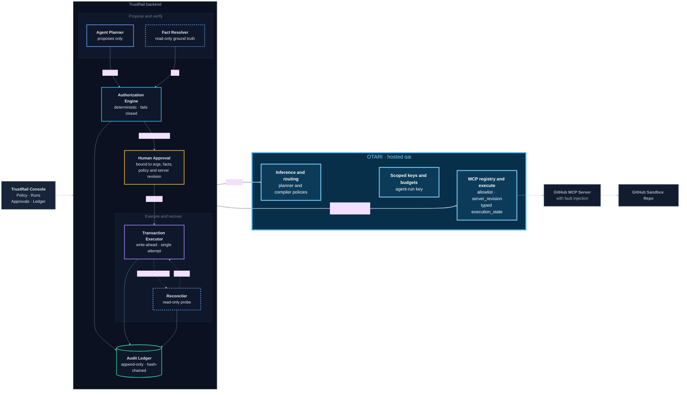

# TrustRail

### The Authorization and Transaction-Control Layer for AI Agents

**TrustRail** is a deterministic authorization and transaction-control layer that sits between AI agents and the tools they use to interact with external systems.

As AI agents become capable of executing real-world actions through APIs and tools, giving them unrestricted execution access introduces significant risks. An agent might perform an unauthorized operation, act on incorrect information, exceed its intended permissions, or leave a system in an uncertain state when a tool call fails.

TrustRail addresses this problem by separating **what an AI agent proposes** from **what it is actually allowed to execute**.

Instead of allowing an LLM to directly execute sensitive operations, TrustRail introduces a controlled execution pipeline in which proposals are evaluated against deterministic policies, authorization decisions are enforced, human approval can be required, and every significant operation is recorded in a verifiable audit ledger.

## The Problem

AI agents are increasingly moving beyond generating text into interacting with external systems through tools, APIs, and MCP servers.

However, agent-driven execution introduces several challenges:

- **Uncontrolled execution:** An agent may attempt operations beyond its intended scope.
- **Unreliable decisions:** LLM-generated decisions are probabilistic and cannot serve as the sole authorization mechanism.
- **Missing accountability:** Traditional agent workflows often lack a complete, verifiable record of what happened and why.
- **Uncertain outcomes:** A tool call can time out or lose its response even when the external operation may have succeeded.
- **Insufficient human oversight:** Sensitive operations need explicit authorization before execution.

TrustRail provides an independent control layer to address these challenges.

## The Solution

TrustRail implements a controlled execution model:

1. **Propose:** An AI agent analyzes the request and proposes an operation.
2. **Resolve:** Relevant facts about the target resource are retrieved and validated.
3. **Authorize:** A deterministic policy engine evaluates the proposed operation and produces an authorization decision.
4. **Approve:** Operations requiring human authorization are held until an explicit approval is received.
5. **Execute:** Authorized operations are dispatched through controlled tool integrations.
6. **Reconcile:** Execution outcomes are classified, including cases where the external result cannot be determined immediately.
7. **Audit:** Every significant operation and state transition is recorded in an append-only, hash-chained audit ledger.

The LLM is responsible for planning and proposing actions. TrustRail is responsible for authorization and execution control.

## Core Capabilities

| Capability | Description |
|---|---|
| Deterministic Authorization | Evaluates proposed operations against validated policies rather than trusting LLM decisions. |
| Policy Compilation | Uses an LLM-assisted policy compiler to translate natural-language requirements into structured policies. |
| Human-in-the-Loop Approval | Supports explicit human authorization for sensitive operations. |
| Transaction State Machine | Enforces valid transaction transitions and prevents unauthorized state changes. |
| Controlled Tool Execution | Dispatches approved operations through an explicit set of allowed agent tools. |
| Outcome Classification | Distinguishes successful, failed, safely failed, and indeterminate execution outcomes. |
| Reconciliation | Resolves uncertain transaction outcomes by checking the external system. |
| Tamper-Evident Audit Ledger | Maintains append-only, hash-chained records of transaction and agent execution events. |
| Agent Orchestration | Coordinates planning, tool dispatch, proposal evaluation, and execution workflows. |
| Budget Management | Integrates Otari budget services for tracking agent inference usage. |

## Design Principles

TrustRail is built around a few fundamental principles:

- **LLMs propose, deterministic systems decide.** Probabilistic model outputs never replace the authorization boundary.
- **Fail closed.** Missing, invalid, or insufficient authorization information must not result in permission being granted.
- **Explicit approval.** Sensitive operations require human authorization when policy demands it.
- **Stateful execution.** Every transaction follows a defined lifecycle with validated state transitions.
- **Uncertainty is a first-class state.** An unknown execution outcome must never be silently treated as success or failure.
- **Verifiable accountability.** Execution events are recorded in a hash-chained audit ledger.

## Technology Stack

| Layer | Technologies |
|---|---|
| Language | Python 3.12+ |
| Backend API | FastAPI |
| Data Validation | Pydantic |
| Database | SQLite |
| Agent Integration | Otari |
| Tool Integration | Model Context Protocol (MCP) |
| HTTP Client | HTTPX |
| Testing | Pytest |
| Code Quality | Ruff, MyPy |

## Local Setup

TrustRail runs as three local services:

1. the FastAPI authorization backend;
2. the GitHub MCP server; and
3. the Vite frontend.

Run each service in a separate terminal. The commands below assume Linux or macOS
and that you are in the repository root.

### 1. FastAPI backend

Copy the backend environment template, create the virtual environment through the
Makefile, activate it, and start FastAPI:

```bash
cp .env.example .env
make install
source .venv/bin/activate
make run
```

Before starting the backend, open the root `.env` and replace its placeholders with
your own credentials and deployment values. Configure the Otari API credentials,
Otari MCP server ID, GitHub personal access token, `owner/repository`, admin token,
planner model, compiler model, and agent API key. Never commit `.env` or put real
credentials in this README.

The API is available at `http://localhost:8000`; interactive documentation is at
`http://localhost:8000/docs`.

### 2. GitHub MCP server

The GitHub MCP server uses the same root `.env` file. In a second terminal, activate
the backend environment first and start the server:

```bash
source .venv/bin/activate
python -m mcp_github.server
```

The MCP server listens on `http://localhost:8001` by default. Ensure the root `.env`
contains valid `MCP_GITHUB_PAT`, `MCP_GITHUB_REPO`, and `TRUSTRAIL_ADMIN_TOKEN`
values. The repository must use `owner/repository` format.

### 3. Frontend

In a third terminal, copy the frontend environment template, configure the backend
URL, install dependencies, and start Vite:

```bash
cd frontend
cp .env.example .env
npm install
npm run dev
```

Set `VITE_API_BASE_URL` in `frontend/.env`:

```dotenv
VITE_API_BASE_URL=http://localhost:8000
```

Open the frontend URL printed by Vite, normally `http://localhost:5173`.

### Credential checklist

- Put backend and MCP credentials in the root `.env`.
- Put frontend configuration, such as `VITE_API_BASE_URL`, in `frontend/.env`.
- Use your own credentials in both files where the templates require values. Do not
  share credentials in source files, screenshots, commits, or documentation.
- Confirm that `.env` files remain untracked before committing:

```bash
git status --short
```

### Architecture Diagram
